<div align="center">


# LearnHub

**Estudos, grana, hábitos e carreira. Num painel só.**

Organização para estudantes: o livro que você está lendo, o saldo do mês, o que você está aprendendo e as vagas em que se inscreveu, sincronizados no computador e no celular.

<br />


<br />

<a href="#como-rodar">Como rodar</a> ·
<a href="#como-funciona">Como funciona</a> ·
<a href="#tecnologias">Tecnologias</a> ·
<a href="#arquitetura">Arquitetura</a> ·
<a href="#system-design">System design</a>

<br /><br />


</div>

<br />

## Sobre

O LearnHub reúne quatro áreas da vida de estudante em um único painel:

| Módulo | O que você faz |
|---|---|
| **Biblioteca** | Cadastra livros (com busca automática de capa e páginas), marca a página atual, avalia e escreve anotações. |
| **Finanças** | Registra entradas e saídas, acompanha saldo, gastos e reserva, e vê um gráfico dos últimos 6 meses. |
| **Habilidades** | Mapeia o que está aprendendo, acompanha o nível de domínio e recebe sugestões de próximo passo. |
| **Carreira** | Acompanha cada candidatura da inscrição à aprovação e define metas (cursos, certificações, idiomas). |

Tudo fica salvo na nuvem e aparece na hora em qualquer aparelho.

<br />

## Como funciona

### 1. Entrar

Login com e-mail e senha, cadastro em três etapas e recuperação de senha por e-mail.

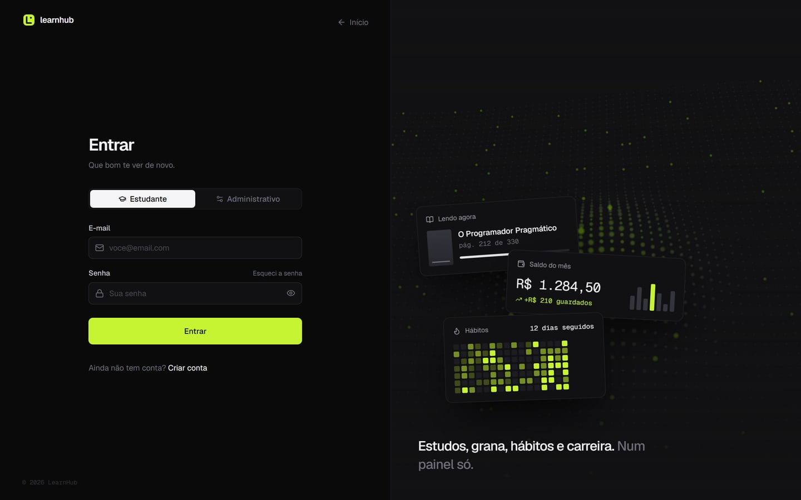

### 2. O painel

Depois de entrar, o painel resume os quatro módulos com dados reais: o livro em andamento, o saldo (que pode ser ocultado), o domínio médio das habilidades e a última candidatura.

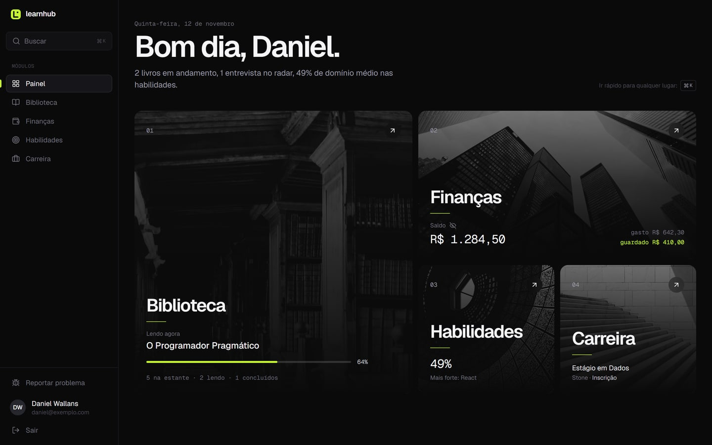

### 3. Do card ao módulo

Ao clicar em um card, os outros recuam e a tela do módulo nasce do tamanho e da posição daquele card, expandindo até ocupar a tela. Cada módulo tem uma tela de entrada com a foto, uma frase e os números principais.

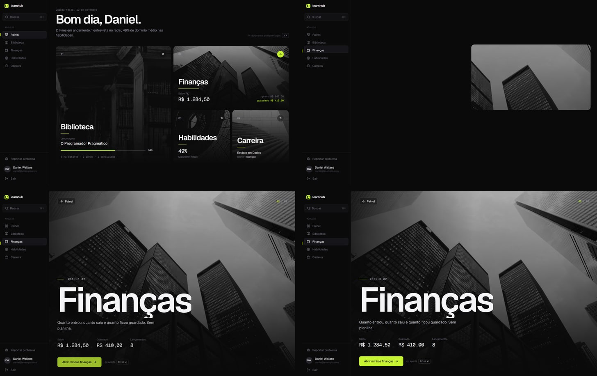

Ao entrar, a foto encolhe e vira o banner do topo do módulo. A animação é a mesma imagem se transformando, não uma troca de tela.

### 4. Os módulos

<table>
  <tr>
    <td width="50%">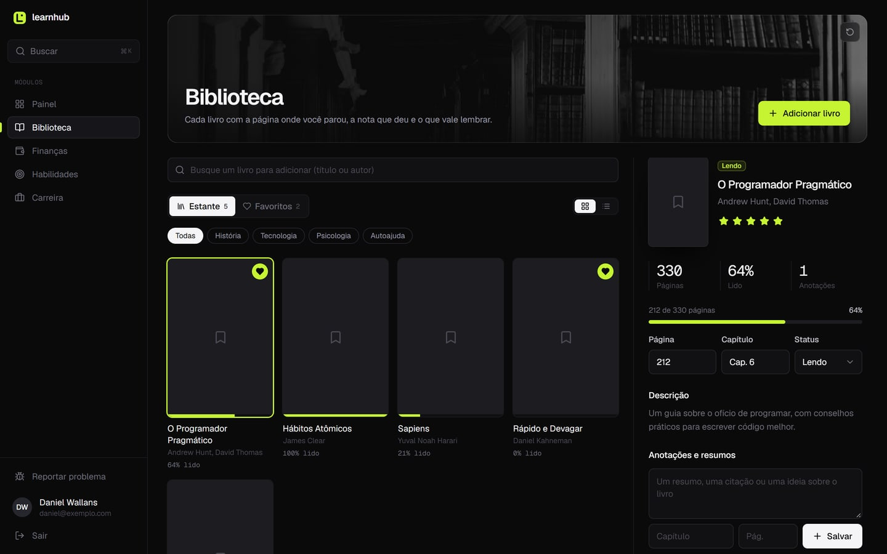<br /><b>Biblioteca</b>: estante em grade ou lista, favoritos, progresso por página, avaliação e anotações.</td>
    <td width="50%">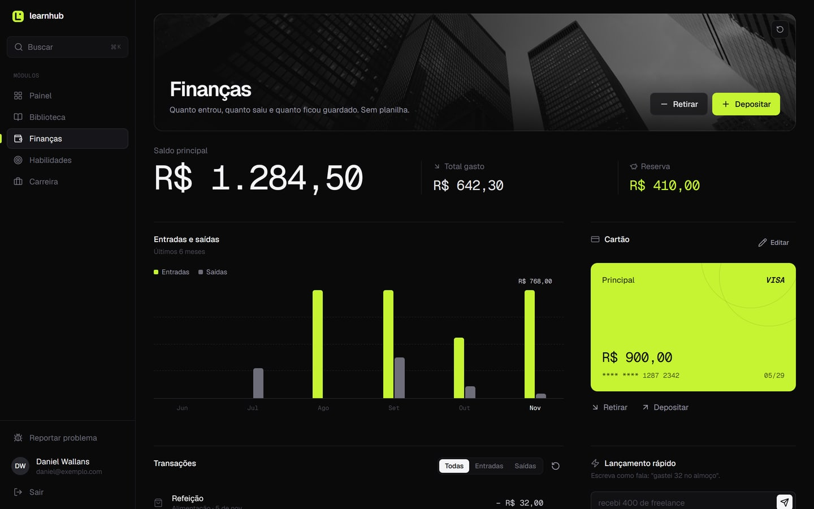<br /><b>Finanças</b>: saldo, gastos e reserva, gráfico mensal, cartão e lançamento rápido por texto.</td>
  </tr>
  <tr>
    <td width="50%">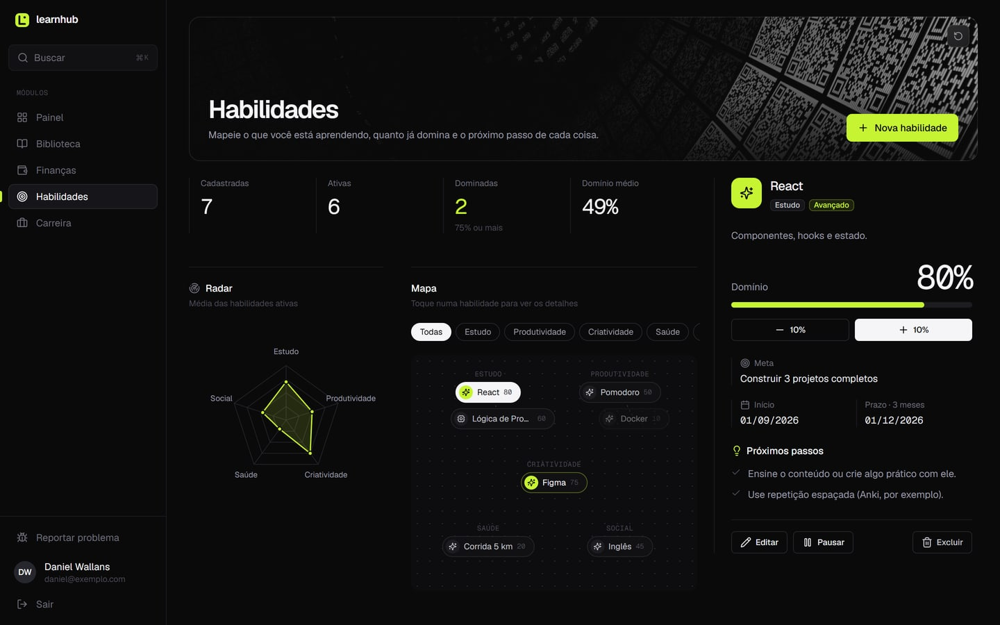<br /><b>Habilidades</b>: radar por categoria, mapa das habilidades e dicas de próximo passo.</td>
    <td width="50%">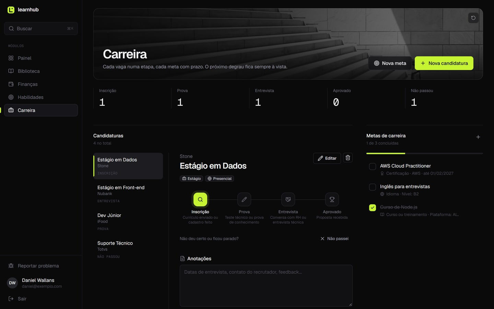<br /><b>Carreira</b>: funil de candidaturas, etapas de cada processo, anotações e metas.</td>
  </tr>
</table>

### 5. Lançamento rápido

Em Finanças, dá para registrar escrevendo do jeito que se fala. O texto é interpretado por regras (não é IA):

| Você escreve | O LearnHub registra |
|---|---|
| `gastei 32 no almoço` | Saída de R$ 32,00 em "Refeição" |
| `recebi 800 de bolsa` | Entrada de R$ 800,00 em "Bolsa de estudos" |
| `guardei 100` | R$ 100,00 do saldo vão para a reserva |

### 6. Busca rápida

<kbd>Ctrl</kbd> + <kbd>K</kbd> (ou <kbd>Cmd</kbd> + <kbd>K</kbd> no Mac) abre a busca para ir a qualquer módulo ou ação sem usar o mouse.

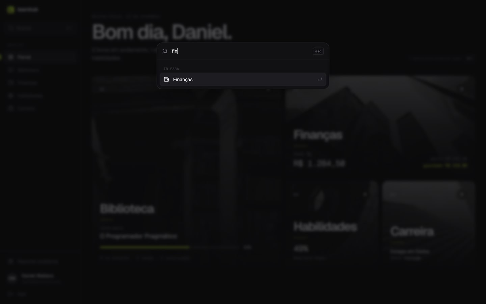

### 7. No celular

A navegação vira um dock embaixo da tela, os campos usam 16 px (o iPhone não dá zoom ao tocar), os alvos de toque têm pelo menos 44 px e as janelas sobem de baixo como uma folha.

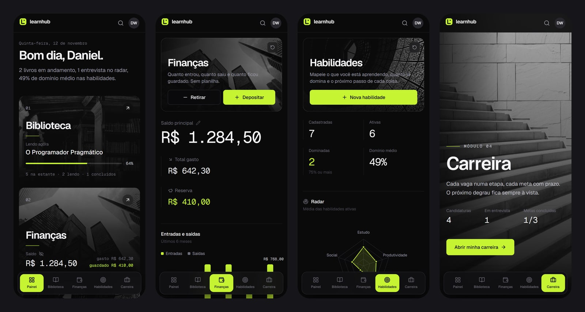

> As imagens usam dados de exemplo.

<br />

## Como rodar

### Pré-requisitos

- [Node.js](https://nodejs.org) 18 ou mais novo
- Um projeto no [Firebase](https://console.firebase.google.com) com **Authentication** (e-mail e senha) e **Cloud Firestore** ativados

### Passo a passo

```bash
# 1. Clone o repositório
git clone https://github.com/DanielWallans/learnhub2.0.git
cd learnhub2.0

# 2. Instale as dependências
npm install

# 3. Rode em modo de desenvolvimento (abre em http://localhost:3000)
npm start
```

### Usando o seu próprio Firebase

1. No console do Firebase, crie um app Web e copie a configuração.
2. Cole os valores em [`src/lib/firebase.js`](src/lib/firebase.js).
3. Em **Authentication > Sign-in method**, ative **E-mail/senha**.
4. Publique as regras de segurança do Firestore (veja [Segurança](#segurança)):

```bash
npx firebase-tools login
npx firebase-tools use --add      # escolha o seu projeto
npx firebase-tools deploy --only firestore:rules
```

> A configuração web do Firebase não é segredo: ela identifica o projeto, e quem protege os dados são as regras do Firestore.

### Scripts

| Comando | O que faz |
|---|---|
| `npm start` | Servidor de desenvolvimento com recarga automática |
| `npm run build` | Gera a versão de produção otimizada em `build/` |
| `npm test` | Executa o Jest (ainda não há testes escritos; veja [Próximos passos](#próximos-passos)) |

### Deploy

O projeto está pronto para a [Vercel](https://vercel.com): importe o repositório e mantenha as opções padrão. O [`vercel.json`](vercel.json) já redireciona todas as rotas para o `index.html` (necessário para o React Router).

<br />

## Tecnologias

| Camada | Tecnologia | Para quê |
|---|---|---|
| Interface | **React 19** | Componentes e estado da aplicação |
| Rotas | **React Router 7** | Navegação, rotas privadas e carregamento sob demanda |
| Estilo | **Tailwind CSS 3.4** | Design system com tokens próprios (`ink` e `lime`) |
| Animação | **Motion 14** | Transições de layout, abas, diálogos e microinterações |
| Animação | **GSAP 3.15** + ScrollTrigger + SplitText | Títulos letra a letra, scroll horizontal fixado e a expansão do card |
| 3D | **Three.js** + **React Three Fiber** | Campo de partículas com shader próprio no hero e no login |
| Dados | **Firebase Auth** + **Cloud Firestore** | Login e banco de dados em tempo real |
| Ícones | **Lucide** | Ícones consistentes (o app não usa emojis) |
| Fontes | **Geist** e **Geist Mono** | Texto e números, servidas junto com o app |
| Build | **Create React App 5** + **CRACO 7** | Build e alias `@/` para `src/` |
| APIs externas | **Google Books** e **Open Library** | Busca de livros, capas e número de páginas |

<br />

## Arquitetura

O código é organizado **por funcionalidade**: cada módulo tem a própria pasta com página, componentes e lógica. Tudo que é compartilhado fica em `components/`, `context/` e `lib/`. Os imports internos usam o alias `@/`.

```
src/
├── app/                      # Ponto de montagem da aplicação
│   ├── App.jsx               #   provedores, rotas e carregamento sob demanda
│   └── PrivateRoute.jsx      #   bloqueia rotas sem login
│
├── components/               # Compartilhado entre módulos
│   ├── ui/                   #   design system: botão, campos, diálogo, toasts, abas...
│   ├── layout/               #   AppShell (sidebar + dock), ModuleFrame (intro + banner),
│   │                         #   CommandPalette (Ctrl+K), AuthLayout, transição do card
│   └── brand/                #   logo
│
├── context/
│   ├── AuthContext.jsx       # sessão do Firebase + tipo de conta (aluno/admin)
│   └── StudentContext.jsx    # perfil do aluno em tempo real
│
├── features/                 # Um diretório por funcionalidade
│   ├── landing/              #   página inicial (hero 3D, scroll horizontal, recursos)
│   ├── auth/                 #   login, cadastro, recuperação de senha, boas-vindas
│   ├── painel/               #   painel com os cards dos módulos
│   ├── leitura/              #   Biblioteca
│   │   ├── LeituraPage.jsx
│   │   ├── components/       #     BookDetail, BookCover, Stars
│   │   ├── lib/              #     busca (Google Books / Open Library), constantes
│   │   └── data/             #     base local de livros para busca instantânea
│   ├── financas/             #   Finanças (gráfico, lançamento rápido, cartão)
│   ├── habilidades/          #   Habilidades (radar, mapa, dicas)
│   ├── carreira/             #   Carreira (etapas, candidaturas, metas)
│   └── conta/                #   perfil e relatório de problemas
│
├── lib/
│   ├── firebase.js           # inicialização do Firebase
│   ├── collections.js        # nomes das coleções do Firestore em um só lugar
│   └── utils.js              # cn() para juntar classes do Tailwind
│
├── assets/modules/           # fotos dos módulos (preto e branco, comprimidas)
└── styles/global.css         # base do Tailwind e ajustes globais
```

### Convenções

- **Páginas** terminam em `Page.jsx` e ficam na raiz da pasta do módulo.
- **Lógica sem interface** (cálculos, chamadas externas, constantes) fica em `lib/` do módulo, separada dos componentes.
- **Nomes de coleção** nunca são escritos à mão: sempre `COL.leitura`, `COL.candidaturas`, etc.
- **Feedback** usa `useFeedback()` (toasts e confirmação), nunca `alert()` ou `window.confirm()`.
- **Paleta fixa** de três cores: tinta (`ink-*`), branco (`ink-50`) e o destaque `lime`.

<br />

## System design

### Visão geral

O LearnHub é uma SPA estática (hospedada na Vercel) que fala direto com o Firebase. Não existe servidor próprio: a autenticação é do Firebase Auth, e o acesso aos dados é controlado pelas regras do Firestore.

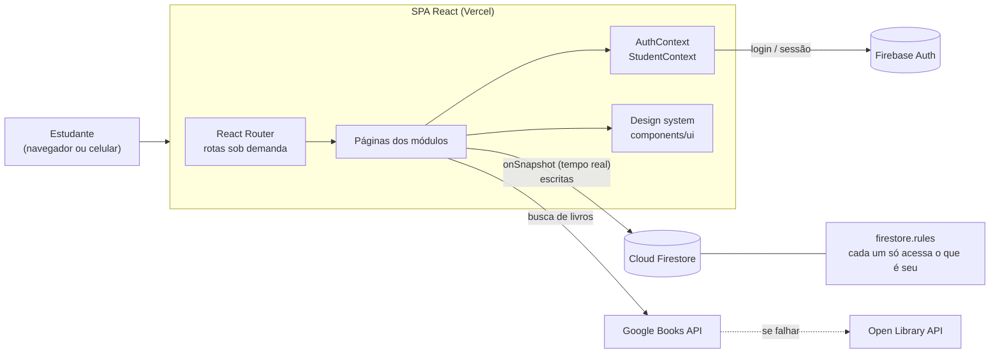

### Fluxo de autenticação

O app espera o perfil ser confirmado no Firestore antes de abrir qualquer rota privada, para nunca redirecionar alguém logado de volta para o login.

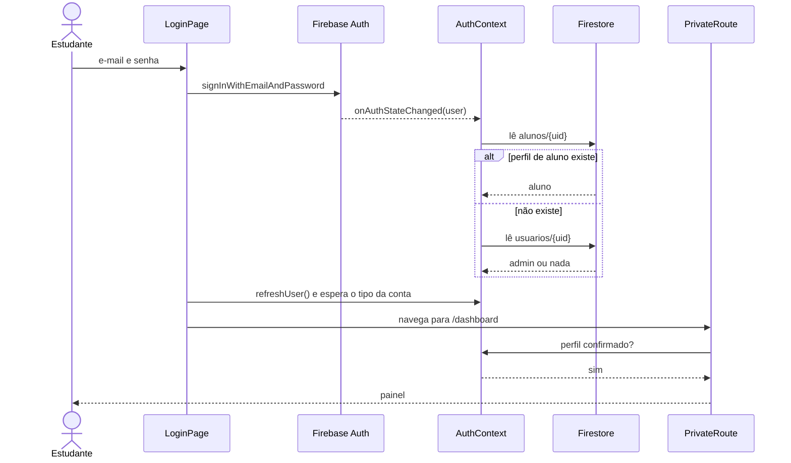

### Modelo de dados

Cada registro pertence a um estudante: ou o id do documento é o próprio `uid`, ou o documento tem o campo `userId`.

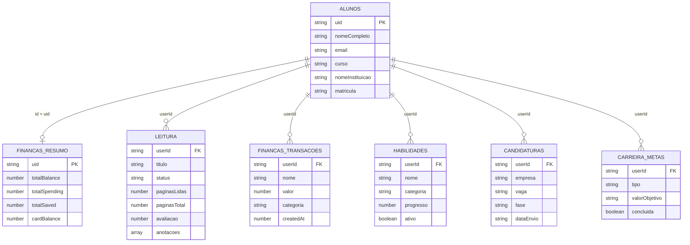

### Fluxo de dados nos módulos

1. A página assina as coleções do usuário com `onSnapshot` (`where('userId', '==', uid)`).
2. Toda escrita vai direto para o Firestore; a tela se atualiza sozinha quando o snapshot chega, sem estado duplicado.
3. Em Finanças, cada lançamento grava a transação **e** atualiza o resumo (`financas_resumo/{uid}`). Excluir um lançamento desfaz o efeito no saldo, nos gastos e na reserva.

### Segurança

As regras em [`firestore.rules`](firestore.rules), depois de publicadas no projeto Firebase, garantem que:

- cada pessoa só lê e escreve os próprios documentos;
- ninguém consegue criar um registro em nome de outra pessoa nem trocar o dono de um registro existente;
- relatórios de problema podem ser enviados por quem está logado, mas não lidos pelo app.

A senha nunca é gravada no Firestore: ela fica só no Firebase Authentication. A matrícula é gerada no navegador, sem consultar outros alunos, o que permite manter a coleção `alunos` fechada.

### Desempenho

- **Rotas sob demanda:** cada tela baixa o próprio código só quando é aberta, e o painel pré-carrega os módulos em segundo plano.
- **3D só depois do texto:** a cena Three.js carrega depois do conteúdo principal.
- **Imagens leves:** as fotos dos módulos passaram de 12 MB para cerca de 0,9 MB.
- **Fontes locais:** Geist é servida junto com o app, sem depender do Google Fonts.

### Acessibilidade

- Quem ativa "reduzir movimento" no sistema vê a interface sem as animações grandes.
- Ícones sempre acompanham texto ou `aria-label`; o gráfico tem uma tabela equivalente para leitores de tela.
- Alvos de toque de pelo menos 44 px e campos sem zoom automático no iPhone.

<br />

## Próximos passos

- [ ] Migrar de Create React App para Vite
- [ ] Testes automatizados dos fluxos principais
- [ ] Busca de conteúdo (livros, vagas, habilidades) no Ctrl+K
- [ ] Modo offline com sincronização

<br />

## Autor

Feito por **Daniel Wallans** · [github.com/DanielWallans](https://github.com/DanielWallans)
